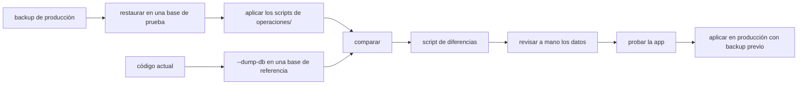

# Actualización de una instalación existente

Una instalación nueva se arma con el volcado que genera `npm start -- --dump-db` (ver [arquitectura.md](arquitectura.md)). Una instalación que ya está en producción se actualiza de una de dos formas, según qué tan atrasada esté.

| Caso | Cómo |
| :-- | :-- |
| Al día o con pocas versiones de atraso | Scripts de `operaciones/` posteriores al commit instalado, en orden de fecha |
| Muy atrasada, o no se sabe qué scripts se aplicaron (discon) | Aplicar los scripts de `operaciones/` que se puedan y completar con el script de diferencias que genera el comparador contra el volcado del código actual |

## Qué hay que saber antes de empezar

1. **La versión instalada.** El commit de dmencu que corre en el servidor y las versiones de las dependencias que tocan el esquema (`meta-enc`, `procesamiento`, `operativos`, `backend-plus`). Salen de `npm ls` en el directorio del servidor.
2. **Un backup reciente**, restaurado en una base de prueba. No se prueba nada sobre producción.
3. **Los nombres de la instalación:** base, owner y usuario admin (por ejemplo `discon_db`, `discon_owner`, `discon_admin`). Los scripts de `operaciones/` traen nombres de ejemplo o comentados; hay que reemplazarlos.

## Instalación al día: scripts de `operaciones/`

Se aplican los creados después del commit instalado (`git log --diff-filter=A <commit>..HEAD -- operaciones`), en orden de fecha, cada uno en su transacción (`psql -1 -v ON_ERROR_STOP=1`) y con el owner (`set role`). Primero en la base de prueba y después en producción, con backup previo.

## Instalación muy atrasada: scripts más comparación con el volcado

Es un procedimiento manual y pensado para pocas veces al año. Se aplican primero los scripts de `operaciones/` que se pueden correr y después se compara el resultado contra lo que el código actual espera; el script de diferencias completa lo que esos scripts no cubren.

No alcanza con comparar el backup directamente: se probó en discon y falla, porque entre versiones hay cambios que no son solo de estructura. Por ejemplo `no_rea` suma `operativo` a su clave primaria y cambia de tipo, y el comparador no sabe cómo convertir esos datos. Esas conversiones están en los scripts de `operaciones/`.



1. **Restaurar** el backup en una base nueva, con el mismo owner que en producción (`pg_restore`). Si el servidor es de una versión anterior, el aviso `transaction_timeout` es inofensivo.
2. **Armar la referencia:** con la configuración de la instalación (`BACKEND_PLUS_LOCAL_CONFIG=local-config-<app>.yaml npm start -- --dump-db`) se genera `local-db-dump.sql`; se carga en una base vacía. Esa base es el esquema exacto que espera el código.
3. **Aplicar los scripts** de `operaciones/` posteriores al commit instalado (`git log --diff-filter=A <commit>..HEAD -- operaciones`), en orden de fecha, cada uno con `psql -1 -v ON_ERROR_STOP=1` y el owner. Los que no se pueden correr (ver la tabla de problemas) se saltean: los cubre el script de diferencias.
4. **Generar el script** con el comparador (ver abajo). Compara tablas, columnas y tipos, restricciones, funciones (por cuerpo), triggers y los datos básicos (roles, permisos, modos de dm), y escribe el script de diferencias, repetible.
5. **Revisar a mano lo que la comparación no ve**, porque solo mira la estructura:
   - columnas `not null` sin valor por defecto: el script las deja comentadas para completar y fijar;
   - cambios de tipo que necesitan una regla (el script usa un cast simple);
   - datos que cambiaron de significado entre versiones;
   - objetos que el código ya no usa y hay que eliminar (el script elimina las funciones que ya no están y el trigger viejo de tarea próxima).
6. **Probar:** abrir la app contra la base de prueba con un launch específico, correr el script una segunda vez (tiene que ser repetible) y recorrer las pantallas principales.
7. **Producción:** backup, ventana de mantenimiento, script con el owner, deploy del código nuevo.

### El comparador

Es `script/comparar-bd.js` del paquete [coderun](https://github.com/codenautas/coderun): un solo archivo de Node que usa `psql` y `pg_dump`, sin módulos. Para discon se corrió así:

```sh
PGPASSWORD=... node coderun/script/comparar-bd.js --referencia discon_ref_db --origen discon_mig_db     --admin discon_admin --owner discon_owner --host localhost --usuario postgres     --datos modos_dm,roles,roles_permisos,roles_subordinados     --orden modos_dm,semanas,tareas_proximas,historial_tem,diccionario,barrios,fracciones,radios,manzanas     --salida operaciones/discon/2026-10-20-discon-migracion.sql
```

`--datos` son las tablas cuyas filas se copian de la referencia (las que ya existen no se tocan) y `--orden` las tablas nuevas que se crean primero porque otras dependen de ellas. El resto de las opciones está en el encabezado del archivo.

## Problemas que aparecieron al llevar discon de 0.7.10 a 3.6.1

| Problema | Qué hacer |
| :-- | :-- |
| Un script de `operaciones/` supone una tabla que ningún script crea (`historial_tem`, `diccionario`, `tareas_proximas`, `semanas`, cartografía) | Saltearlo y que lo cubra el script de diferencias, o crearla en el script con `create table if not exists` |
| Un script supone una función de `install/` que no está en producción (por ejemplo `comun.cadena_normalizar`) | Incluirla en el script. No usar `esquema_comun.sql` tal cual: hace `drop schema comun cascade` |
| Nombre de rol fijo (`set role dmencu_owner`) | Comentar el `set role` y poner `<app>_owner` en el texto, como pide el CLAUDE.md |
| Columnas `not null` sin valor por defecto en tablas con datos | Agregarla como opcional, completar y recién después fijar `not null` |
| Cambios de tipo (`tem.nrocomuna`, `comunas.comuna` pasaron de entero a texto) | `alter column ... type ... using` |
| Permisos del usuario admin en tablas nuevas | `grant` a `<app>_admin`; los `grant` de tablas que no son del owner los corre un superusuario |
| Tablas y funciones que el código ya no usa (tarea próxima) | Eliminarlas explícitamente, si no el trigger viejo sigue disparándose |
| No se sabe qué scripts se aplicaron | Aplicarlos todos los que se puedan (son repetibles) y completar con el comparador |
| El comparador solo miraba el esquema principal y no creaba las tablas de `his` (`bitacora`, `summary`, `tokens`) ni las secuencias sin dueño | Corregido: sin `his.bitacora` el login da error 500 |

## Para las instalaciones al día (todavía no implementado)

Si las instalaciones se mantienen al día, no hace falta la comparación. Lo que ayuda es:

1. **Registro de lo aplicado.** Una tabla `base.operaciones_aplicadas` (nombre, fecha, usuario) y un comando `npm run actualizar-bd` que aplica en orden, cada uno en su transacción, solo los scripts que faltan y los registra.
2. **Reglas para los scripts** (completan las del CLAUDE.md):
   - repetibles siempre, incluyendo `create table if not exists` para las tablas nuevas y sus triggers;
   - nombres de rol sólo como ejemplo comentado (`<app>_owner`, `<app>_admin`);
   - los datos básicos que necesita el cambio van en el mismo script;
   - cada versión publicada lista en sus notas los scripts que trae.

## Instalaciones con scripts propios

Las migraciones que sólo sirven a una instalación (por ejemplo la de discon) no se versionan: se guardan en `operaciones/<app>/`, excluida con `.git/info/exclude`, con un `LEEME.md` que explique el orden en que se aplican. Lo que genera el comparador es una de esas migraciones.
