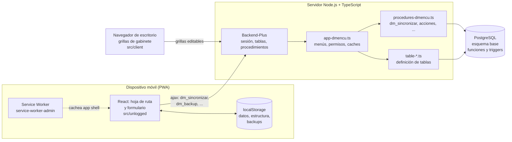
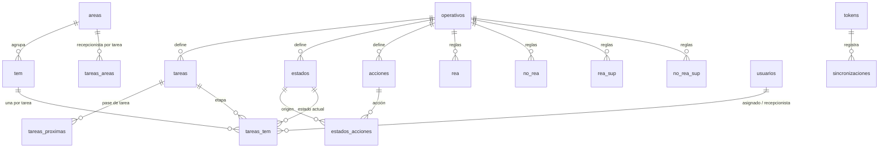

# Arquitectura

dmencu es una aplicación [Backend-Plus](https://github.com/codenautas/backend-plus) sobre PostgreSQL que genera operativos de campo y encuestas a partir de metadatos, con un cliente móvil offline-first.

## Capas

| Capa | Código | Descripción |
| :-- | :-- | :-- |
| Servidor | `src/server` | `app-dmencu.ts` compone la app sobre `meta-enc`, `procesamiento` y `backend-plus`; `procedures-dmencu.ts` expone los procedimientos (API); cada tabla está en su `table-*.ts` |
| Cliente logueado | `src/client` | Pantallas de gabinete (grillas) y wScreens de sincronización y cambio de modo |
| Cliente sin login | `src/unlogged` | Formulario y hoja de ruta en React. Funciona sin conexión; ver [sincronizacion-offline.md](sincronizacion-offline.md) |
| Base de datos | `install/*.sql`, `install/*.tab` | Tablas, funciones y triggers; carga inicial de roles y permisos |
| Migraciones | `operaciones/*.sql` | Scripts de actualización que se ejecutan a mano sobre una base existente |

Los directorios de salida (`dist`) replican la estructura de `src`.

## Modos de la aplicación: policy

La configuración `server.policy` define el modo de la instancia (`getModoByPolicy` en `app-dmencu.ts`):

| policy | Modo | Quién la usa | Menú |
| :-- | :-- | :-- | :-- |
| `web` | `RELEVAMIENTO` | Dispositivos de campo | Hoja de ruta, sincronizar, cambiar modo |
| cualquier otra | `GABINETE` | Oficina | Asignación, recepción, supervisión, control, procesar, configurar, etc. según rol |

Ver [roles-y-permisos.md](roles-y-permisos.md).

## Modelo de datos (resumen)

- **`tem`**: una fila por encuesta. Guarda `tarea_actual`, `habilitada`, los resultados calculados (`rea`, `norea`, `resumen_estado` y sus versiones `_sup`) y los datos del marco (calle, número, barrio, etc.). Las respuestas completas de la encuesta están en las tablas generadas por la unidad de análisis principal.
  - La grilla `tem` es de consulta: sólo se edita `habilitada`. Los datos que se corrigen a mano (`cita`, `result_sup`, `fin_campo`, `proie`, `nrocatastral`, `piso`, `departamento`, `habitacion`, `nromanzana`, `casa`) se editan en la grilla auxiliar `tem_edicion` (`table-tem_edicion.ts`, al lado de TEM en *configurar → muestra*), cuyos campos editables tienen `table:'tem'` para que backend-plus los grabe en `tem`. `nromanzana`, `casa`, `nrocatastral`, `piso`, `departamento` y `habitacion` los edita quien tiene `campo.administrar` (subcoordinador para arriba).
- **`tareas_tem`**: una fila por encuesta y tarea. Guarda el `estado` de esa tarea, quién está `asignado`, el `recepcionista`, la `operacion` pendiente (`cargar` / `descargar`) y `cargado_dm` (token del dispositivo que la tiene).
- **`estados`, `acciones`, `estados_acciones`, `tareas_proximas`**: definen el workflow; ver [tareas-estados-acciones.md](tareas-estados-acciones.md).
- **`areas` / `tareas_areas`**: agrupación de encuestas en cargas de trabajo y el recepcionista de cada carga por tarea.
- **`rea`, `no_rea`, `rea_sup`, `no_rea_sup`**: reglas que clasifican una encuesta como realizada o no; ver [rea-no-rea.md](rea-no-rea.md).
- **`tokens` y `sincronizaciones`**: identifican cada dispositivo y guardan un registro (JSON completo) de cada sincronización.

## Dónde vive la lógica de negocio

Parte importante de las reglas están en PostgreSQL a propósito, para que no puedan saltearse modificando el backend (ver [CLAUDE.md](../CLAUDE.md)). Antes de tocar una regla, buscar si ya existe una función o trigger:

| Archivo en `install/` | Regla |
| :-- | :-- |
| `accion_cumple_condicion.sql` | Evalúa si una acción de `estados_acciones` puede ejecutarse sobre una encuesta (usa la `condicion` de la acción y exige `tem.habilitada`) |
| `tarea_cumple_condicion.sql` | Evalúa la condición de un pase de tarea (`tareas_proximas`) |
| `asignar_desasignar_tareas_tem_trg.sql` | Al asignar la tarea inicial fija `tem.tarea_actual`; al desasignarla la anula |
| `sincronizacion_tareas_tem.sql` | `cargado` se deriva de `cargado_dm` |
| `validar_domicilio_tem_trg.sql` | `tem.nromanzana`, `tem.casa`, `tem.nrocatastral`, `tem.piso`, `tem.departamento` y `tem.habitacion` sólo se pueden modificar si el `dominio` (el anterior al update) es 5. En bases ya instaladas se agrega con `operaciones/2026-10-30-actualizar_validar_domicilio_tem.sql` |
| `validar_tareas_tem_trg.sql` | Al asignar: exige que la encuesta esté habilitada, que el estado permita asignar (`estados.permite_asignar`), que haya recepcionista y que la tarea sea la actual o la inicial; no deja quitar el recepcionista de una encuesta asignada |
| `desverificar_tarea_trg.sql` | Al desverificar una tarea: sólo si es la última anterior a la actual y la siguiente no está verificada ni asignada; en ese caso `tem.tarea_actual` vuelve a ella |
| `control_cargado_tareas_tem_trg.sql` | Una encuesta no puede tener `operacion = 'cargar'` si ya está cargada en un dispositivo, o ya tiene `cargar` pendiente, para otra tarea |
| `control_disform_cerrado_trg.sql` | Impide modificar `casilleros` y `unidad_analisis` de un operativo con el diseño de formularios cerrado (`operativos.disform_cerrado`) |
| `agregar_historial_tem_trg.sql` | Al cambiar `tem.tarea_actual`, guarda en `historial_tem` una foto de la tarea que se deja (estado, asignado, recepcionista, resumen, REA/no REA y JSON de la encuesta) |
| `sincro_tareas_areas_tareas_tem_trg.sql` | Al asignar o cambiar recepcionista en `tareas_areas`, lo propaga a las `tareas_tem` de las encuestas del área (excepto las autogeneradas en el dispositivo) |

## Caches del servidor

`app-dmencu.ts` mantiene en memoria (`be.caches`) datos que casi no cambian y que se piden en cada request:

- Permisos por rol (`permisosRol`, `permisosSuperuser`, `permisosParaNadie`), cargados desde la base en `postConfig`.
- Contenido de las tablas `rea`, `no_rea`, `rea_sup`, `no_rea_sup` y su agrupamiento, más la configuración del operativo (`tableContent`).
- `timestampEstructura`: marca de versión de la estructura del formulario.

Al guardar o borrar un registro de las tablas de REA/no REA, o de casilleros o semanas, se actualiza `timestampEstructura` y las caches se recargan (`refrescarEstructuraAlModificarTabla`). Así los dispositivos detectan que la estructura cambió.
