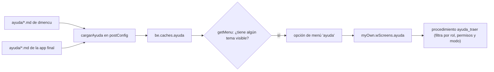
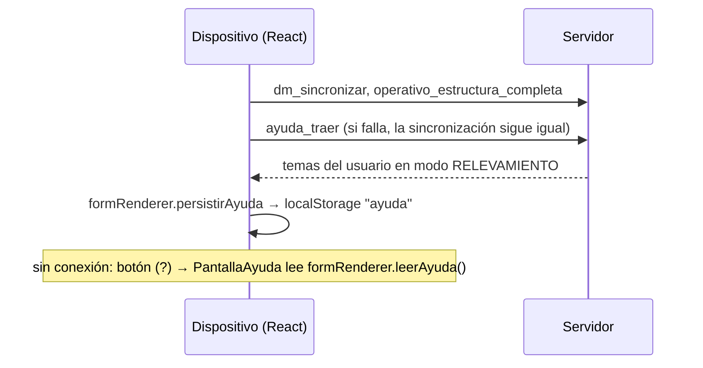

# Ayuda en línea para usuarios

La opción **ayuda** del menú muestra a cada persona logueada los temas que le corresponden según su **rol**, sus **permisos** y el **modo** de la instancia (policy: RELEVAMIENTO en dispositivos, GABINETE en el resto). Es ayuda para usuarios. La documentación para desarrolladores sigue en esta carpeta `docs/` y no se muestra en la app.

## Cómo funciona



| Pieza | Dónde |
| :-- | :-- |
| Temas de dmencu | `ayuda/*.md` (se publica en el paquete npm) |
| Lectura, combinación y filtro | `src/server/ayuda.ts` |
| Fuentes, carga y validación | `getAyudaFuentes`, `postConfig` y `problemasDeAyuda` en `src/server/app-dmencu.ts` |
| Quién ve qué | `quienConsultaAyuda(context)` en `app-dmencu.ts` y `temaVisible` en `ayuda.ts` |
| Opción de menú | al final de `getMenu`, sólo si el usuario tiene algún tema visible |
| Procedimiento | `ayuda_traer` en `src/server/procedures-dmencu.ts` |
| Pantalla en gabinete | `myOwn.wScreens.ayuda` en `src/client/client.ts`; estilos en `src/client/css/menu.styl` |
| Pantalla en el dispositivo | `PantallaAyuda` en `src/unlogged/render-formulario.tsx`; estilos en `src/unlogged/css/formulario-react.styl` (ver abajo) |
| Tipos | `AyudaFuente` y `AyudaTema` en `types-dmencu.ts`; `AyudaParaUsuario` en `src/unlogged/tipos.ts` |
| Tests | `src/test/test-ayuda.ts` |

El filtro se hace **en el servidor**: un usuario nunca recibe temas que no le corresponden. El markdown se convierte a html al iniciar (con `markdown-it`, sin html crudo).

La pantalla tiene un índice con los temas y una página generada, **Qué puedo hacer**, que recorre el menú real del usuario (el que arma `getMenu`) y enlaza cada opción con el tema que la explica. Si una app final cambia el menú, esa página cambia sola.

### En el dispositivo (React, sin conexión)

La app del dispositivo (`/campo`) no usa el menú de backend-plus, y la página del menú no está en el cache del service worker. Por eso la ayuda del dispositivo funciona así:



| Pieza | Dónde |
| :-- | :-- |
| Descarga al sincronizar | `descargarAyuda` en `src/unlogged/unlogged.ts`, llamada desde `sincronizarDatos` |
| Almacenamiento | `leerAyuda` / `persistirAyuda` de `FormularioConfig` (`render-config.ts`); la implementación con `localStorage` está en `render-init.ts` (`GLOVAR_AYUDA`). Una app que use otro almacenamiento los reemplaza como hace con `leerEstructura` / `persistirEstructura` |
| Pantalla | `PantallaAyuda` en `render-formulario.tsx`, pantalla `'ayuda'` de `PantallaNavegacion` |
| Acceso | botón (?) en `BotoneraNavegacion`, que aparece si hay temas guardados |

La pantalla de ayuda del menú de gabinete (`client.ts`) usa el mismo almacenamiento: si no puede traer la ayuda del servidor, muestra la última guardada.

Como la ayuda llega en la sincronización, un cambio en los temas llega al dispositivo en la próxima sincronización. Los temas del dispositivo describen la interfaz React (botones *Hoja de Ruta*, *Sincronización*, menú ⚙). Su campo `menu:` apunta a las opciones del menú de backend-plus (`relevamiento`, `sincronizar`, `cambiar_modo`), que se usan en *Qué puedo hacer*.

## Formato de un tema

Un archivo `.md` con un encabezado YAML entre líneas `---`:

```markdown
---
id: asignacion
titulo: Asignación
orden: 20
modo: GABINETE
permisos: [campo.editar]
menu: [asignacion, asignacion/encuestador]
---
En **asignación** se decide quién hace cada tarea. Ver también [Recepción](ayuda:recepcion).
```

| Campo | Obligatorio | Significado |
| :-- | :-: | :-- |
| `id` | sí | Identificador único (minúsculas, números, `_` y `-`). Es lo que se usa para reemplazar u ocultar el tema desde una app final |
| `titulo` | sí (salvo con `ocultar`) | Lo que aparece en el índice |
| `orden` | no (100) | Orden en el índice; a igual orden, alfabético por título |
| `permisos` | no | Lista de `permiso.accion` (ver `install/permisos.tab`). Alcanza con tener **alguno** |
| `roles` | no | Lista de roles. Alcanza con tener **alguno** |
| `modo` | no | `RELEVAMIENTO` o `GABINETE`; vacío = en ambos |
| `menu` | no | Rutas de las opciones del menú que explica el tema: los `name` de las opciones separados por `/` (por ejemplo `configurar/metadatos`). Se usa en *Qué puedo hacer* |
| `ocultar` | no | `true` quita el tema con ese `id` de una fuente anterior |

Quién lo ve:

- Si el tema tiene `modo` y no coincide con el de la instancia, no lo ve nadie.
- Un `superuser` ve todos los temas de su modo.
- Un tema sin `permisos` ni `roles` lo ve cualquier usuario logueado.
- Si el tema tiene `permisos`, `roles` o los dos, lo ve quien tenga alguno de los permisos o alguno de los roles.

Para enlazar a otro tema se usa `[texto](ayuda:id)`. Los demás enlaces se abren en otra pestaña.

Conviene escribir los temas por permiso (`permisos`) antes que por rol: así siguen valiendo si se crea un rol nuevo con esos permisos.

## Cómo extender la ayuda en una app final

1. Crear la carpeta `ayuda/` en la raíz de la app, con sus `.md`. Agregarla a `"files"` del `package.json` si la app se publica como paquete.
2. Sobreescribir `getAyudaFuentes` en la clase de la app, agregando la carpeta **después** de las de dmencu:

```ts
import { carpetaDelPaquete } from 'dmencu';
import * as path from 'path';

export function emergeAppEtoi<T extends Constructor<dmencu.AppAppDmEncuType>>(Base: T) {
  return class AppEtoi extends Base {
    override getAyudaFuentes() {
      return [
        ...super.getAyudaFuentes(),
        { origen: 'etoi', carpeta: path.join(carpetaDelPaquete(__dirname), 'ayuda') },
      ];
    }
  }
}
```

Las fuentes se combinan en orden:

| Si la app tiene un tema con... | Resultado |
| :-- | :-- |
| un `id` nuevo | se agrega |
| el mismo `id` que uno de dmencu | lo **reemplaza** (por ejemplo, si la app cambió la pantalla de asignación) |
| el mismo `id` y `ocultar: true` | lo **quita** (por ejemplo, si la app sacó el menú *control*) |

```markdown
---
id: control
ocultar: true
---
```

`carpetaDelPaquete(__dirname)` busca hacia arriba la carpeta con `package.json`, así que funciona igual desde `dist/server/server`, desde los tests o dentro de `node_modules`.

Si la app agrega opciones al menú (`getMenuVarios`, etc.), conviene agregar un tema con `menu:` apuntando a esas rutas para que aparezcan con ayuda en *Qué puedo hacer*.

Si la app tiene otra forma de decidir quién ve qué, se puede reemplazar la función `temaVisible` de `ayuda.ts`. Para eso hay que cambiar `quienConsultaAyuda` y el procedimiento `ayuda_traer` en dmencu, porque hoy no son métodos que se puedan sobreescribir.

## Validación

Al iniciar, `postConfig` carga la ayuda:

- **Corta el arranque** si hay un error de formato: falta el encabezado, hay un campo desconocido, un modo inválido, un permiso sin acción o un `id` repetido en la misma carpeta.
- **Avisa por consola** (con `problemasDeAyuda()`, sin cortar) si un tema del modo actual menciona permisos o roles que no existen en la base, o rutas de menú que ningún rol tiene.

En los tests de la app final conviene repetir el chequeo en ambos modos, como hace `src/test/test-ayuda.ts`:

```ts
var be = crearAppParaTests('');            // GABINETE; 'web' para RELEVAMIENTO
be.caches.ayuda = cargarAyuda(be.getAyudaFuentes());
assert.deepStrictEqual(be.problemasDeAyuda(), []);
```

## Mantenimiento

Cada vez que se agregue o cambie una opción de menú o una funcionalidad que usan las personas, hay que agregar o actualizar su tema en `ayuda/`. Los textos van dirigidos al usuario (sin nombres de tablas ni de procedimientos) y en el mismo tono que los existentes.
