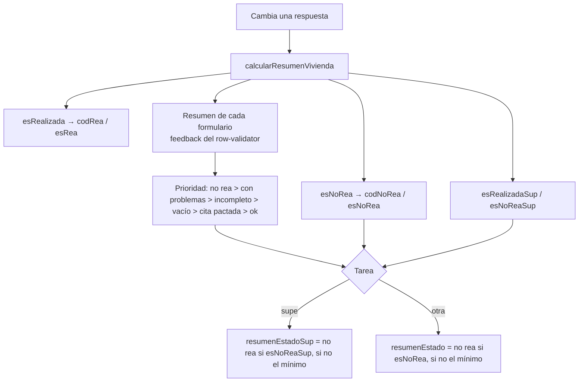

# REA, no REA y resumen de estado

Cada encuesta tiene un **resultado** que se calcula en el dispositivo (y en gabinete) mientras se la completa: si fue realizada (REA), si es un caso de no respuesta (no REA) y en qué estado de completitud está. Estos datos se guardan en la TEM y alimentan la hoja de ruta, la supervisión y los controles de campo.

Hay dos juegos de reglas paralelos: el de la encuesta (`rea`, `no_rea`) y el de **supervisión** (`rea_sup`, `no_rea_sup`), que se usa cuando la tarea es `supe`.

## Dónde se definen

Son tablas de metadatos del operativo, editables desde *configurar → metadatos → rea/norea* por quien tiene permiso para editar metadatos (ver [roles-y-permisos.md](roles-y-permisos.md)).

| Tabla | Columnas relevantes | Cómo se evalúa |
| :-- | :-- | :-- |
| `rea` | `rea` (código), `orden`, `condicion`, `es_positiva`, `tarea` | `condicion` es una expresión sobre las variables de la encuesta. Se compila a JavaScript (`condicion_js`) en el servidor al armar la estructura |
| `no_rea` | `no_rea` (código), `orden`, `variable`, `valor`, `grupo`, `grupo0`, `pasa_a_recuperacion`, `pasa_a_supervision` | Se cumple si `respuestas[variable] == valor` |
| `no_rea_grupo0` | `grupo0`, `orden`, `es_otras_causas`, `es_no_encuestable`, `es_en_curso` | No se evalúa: declara qué significa cada `grupo0` de `no_rea` para los controles (ver [Grupos de no REA y controles](#grupos-de-no-rea-y-controles)) |
| `rea_sup` | igual que `rea` | Igual que `rea`, para la supervisión |
| `no_rea_sup` | `no_rea_sup`, `orden`, `variable_sup`, `valor_sup`, `grupo_sup`, `grupo0_sup` | Igual que `no_rea` |

Todas tienen `operativo` en la clave: cada operativo define sus propias reglas (pueden no existir en alguno).

## Grupos de no REA y controles

Cada `no_rea` tiene un `grupo` (por ejemplo «otras causas vivienda») y un `grupo0` que agrupa grupos (por ejemplo «otras causas»). `no_rea` es hija de `no_rea_grupo0`: su clave es la del padre más la agregada (`operativo`, `grupo0`, `no_rea`), así que todo código pertenece a un `grupo0` declarado y desde la grilla de `no_rea_grupo0` se abren sus códigos. El código sigue siendo único por operativo (restricción `no_rea_codigo_uk`), porque el sistema identifica la no respuesta por su código (`tem.norea`). Los controles de campo (`control_campo`, `control_resumen` y las que derivan de ellas, ver [tablero.md](tablero.md)) arman una columna por grupo y no conocen sus nombres: lo que significa cada `grupo0` lo declara el operativo en la tabla **`no_rea_grupo0`**, una fila por `grupo0` (`no_rea.grupo0` la referencia).

| Bandera | Qué hace en el control |
| :-- | :-- |
| `es_otras_causas` | los casos de sus grupos suman en «otras causas» (`otras_causas_gabinete`) |
| `es_no_encuestable` | sus grupos no entran en el denominador de la tasa de efectividad |
| `es_en_curso` | sus grupos suman en `en_curso` (por ejemplo las encuestas sin finalizar) |

Un `grupo0` sin marcas no suma en ninguno de los tres. Así una base sin el grupo «otras causas seleccionado» (como ggs) no pide una columna que no existe, y cada operativo decide qué grupos son «en curso» sin tocar el código. Al instalar en una base que ya existe, el script `operaciones/2026-10-20-actualizar_no_rea_grupo0.sql` crea la tabla y la completa a partir de los `grupo0` de `no_rea` (`otras causas`, los que empiezan con `no encuestable` y `no finalizada`).

> `grupo0` también se usa con su nombre en la grilla de hoja de ruta (recuperación y modalidad presencial, ver más abajo). Eso todavía no sale de `no_rea_grupo0`.

## Cómo se determina el resultado

`buscarReaNoReaEnRespuestas` (`src/unlogged/calculos-encuesta.ts`) recorre la lista ordenada por `orden` y devuelve el **primer** ítem que se cumple:

1. Se ignoran los ítems cuya `tarea` esté definida y no coincida con la tarea actual.
2. Un ítem se cumple si su condición JS da verdadero (REA) o si la variable tiene el valor indicado (no REA).
3. Se busca primero a nivel de la unidad de análisis raíz (la vivienda) y, si no hay coincidencia, se desciende por las unidades hijas (hogares, personas...) evaluando cada elemento con el contexto acumulado de sus padres.
4. **REA positiva en un nivel inferior:** si el ítem es una REA positiva (`es_positiva = true`) y se cumplió en una unidad hija, debe cumplirse en **todas** las instancias de esa unidad (por ejemplo, todos los hogares) y esa rama debe estar completa; si no, se descarta el ítem y se sigue con el siguiente. Una REA negativa (`es_positiva = false`) alcanza con que se cumpla en una instancia.
5. El resultado es el `codigo` del ítem y si es positivo (`esRea` / `esNoRea`).

> Por eso importa el `orden`: las reglas más específicas o más fuertes deben ir primero, y la base se consulta `order by operativo, orden, código`.

### Estados de resumen

El resumen de cada formulario de la encuesta se combina tomando el de **menor prioridad numérica** (el peor). Colores y significado en [resumen-estados.md](resumen-estados.md).

| Prioridad | Estado |
| :-- | :-- |
| 1 | `no rea` |
| 2 | `con problemas` |
| 3 | `incompleto` |
| 4 | `vacio` |
| 5 | `cita pactada` |
| 6 | `ok` |

Regla especial: si el mínimo es `vacio` pero hay formularios `ok`, el resumen pasa a `incompleto` (la encuesta ya empezó). Si la encuesta es no REA, el resumen es `no rea` sin importar el resto.

Sólo se tienen en cuenta los formularios habilitados de la encuesta (por ejemplo, el individual sólo cuenta para la persona sorteada).

## Dónde se guarda

| Origen | Campos |
| :-- | :-- |
| Dispositivo (en `tareas_tem`, prefijo `dm_`) | `dm_resumen_estado`, `dm_rea`, `dm_norea` y las `_sup` |
| TEM (valor vigente) | `resumen_estado`, `rea`, `norea` y las `_sup` |

- Al sincronizar, `getSettersAndParametersForReaNoReaResumenEstado` (`src/server/setters-rea-no-rea.ts`) arma los `set` del update: para la tarea `supe` usa las columnas `_sup`; para las demás, las comunes.
- Los grupos de no REA (`grupo`, `grupo0`) se usan para decidir pases: la grilla marca como a recuperar (`a_recuperacion`) las encuestas de la tarea `recu` cuyo grupo0 sea ausentes o rechazos, y `modalidad = presencial` cuando el grupo0 es no encuestable o hay supervisión presencial.

## Cómo llegan las reglas al dispositivo

1. Al iniciar el servidor, y cada vez que se guarda o borra un registro en `rea`, `no_rea`, `no_rea_grupo0`, `rea_sup` o `no_rea_sup`, se recargan las caches (`be.caches.tableContent`) y se actualiza `timestampEstructura`.
2. `operativo_estructura_completa` entrega la estructura del operativo; `reasNoReasDelOperativo` filtra las reglas del operativo y compila las condiciones de `rea` y `rea_sup` a JS (`condicion_js`).
3. El dispositivo guarda la estructura en `localStorage` y la usa para evaluar sin conexión.

Cobertura de tests de esta lógica: ver [testing.md](testing.md).
