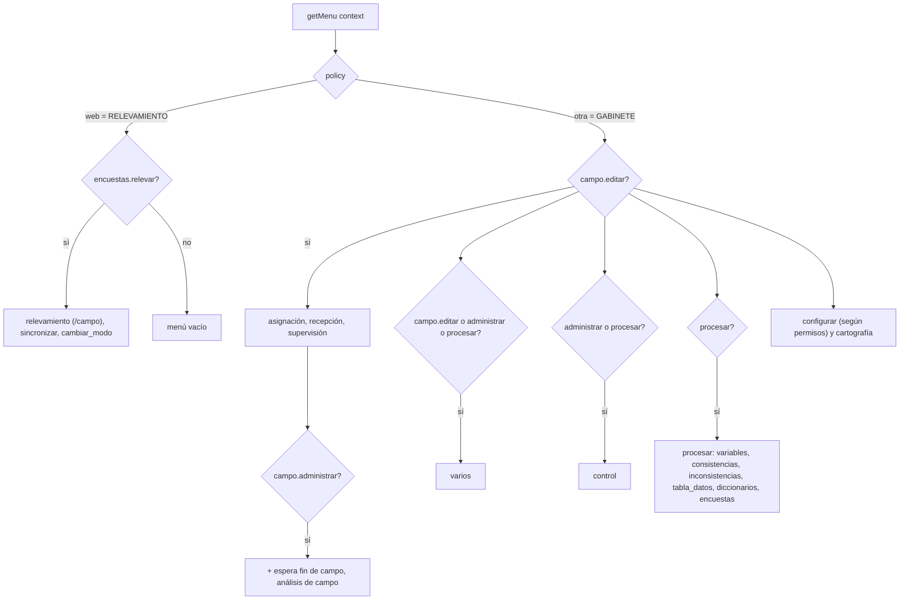

# Roles, permisos y menús

El acceso se controla con **roles**, y cada rol tiene un conjunto de **permisos** (pares `permiso.acción`). El menú que ve una persona depende de sus permisos y del **modo** de la instancia (`policy`).

## Fuentes de datos

| Archivo / tabla | Contenido |
| :-- | :-- |
| `install/roles.tab` → `roles` | Roles y si son `superuser` |
| `install/permisos.tab` → `permisos` | Catálogo de pares permiso/acción con su valor predeterminado (todos `false`) |
| `install/roles_permisos.tab` → `roles_permisos` | Qué acciones tiene habilitadas cada rol |
| `install/roles_subordinados.tab` → `roles_subordinados` | Qué roles puede administrar cada rol (hoy: a quién puede cambiar la contraseña) |
| `usuarios` | Cada usuario tiene un `rol` y un `idper` (id de persona) que se usa en las asignaciones |

Al iniciar el servidor, `postConfig` lee la base y arma `be.caches.permisosRol` (permisos por rol), `permisosSuperuser` (todo `true`) y `permisosParaNadie` (todo `false`). En cada request `getContext` agrega al `context` los permisos del usuario (`context.puede`) y `context.superuser` mediante `permisosSegunUsuario`:

| Caso | Resultado |
| :-- | :-- |
| Sin usuario logueado | `puede` = permisos para nadie |
| Rol superuser (`admin`) | `superuser = true` y `puede` = todos los permisos |
| Rol común | `puede` = permisos del rol |
| Rol inexistente | `puede` indefinido (sin permisos) |

## Permisos

| Permiso.acción | Para qué se usa |
| :-- | :-- |
| `encuestas.relevar` | Releva en dispositivos; habilita el menú del modo RELEVAMIENTO |
| `campo.ver` | Ver la información de campo |
| `campo.editar` | Asignación, recepción, supervisión y varios; editar tablas de campo |
| `campo.administrar` | Administración del campo: espera de fin de campo, análisis de campo, control, y operaciones de gestión (migrar operativo, borrar, etc.) |
| `encuestas.ingresar` | Ingresar encuestas en gabinete |
| `encuestas.justificar` | Justificar inconsistencias |
| `encuestas.procesar` | Procesamiento: menú *procesar*, edición de encuestas en procesamiento, intercambiar encuestas |
| `consistencias.editar` | Editar consistencias |
| `casilleros_texto.editar` | Editar los textos de los casilleros (metadatos), incluidas las tablas de REA/no REA en configuración |
| `configurar.ver` / `configurar.editar` | Menú *configurar* |

## Matriz de roles

Según `install/roles_permisos.tab` (✔ habilitado). `admin` es superuser y tiene todo.

| Rol | relevar | campo ver | campo editar | campo administrar | ingresar | justificar | procesar | consistencias | textos | configurar ver/editar |
| :-- | :-: | :-: | :-: | :-: | :-: | :-: | :-: | :-: | :-: | :-: |
| admin | | ✔ | ✔ | (todo) | ✔ | ✔ | ✔ | ✔ | ✔ | ✔ / ✔ |
| coor_campo | | ✔ | ✔ | ✔ | ✔ | ✔ | ✔ | ✔ | | ✔ / ✔ |
| coor_proc | | ✔ | ✔ | ✔ | ✔ | ✔ | ✔ | ✔ | | ✔ / ✔ |
| subcoor_campo | | ✔ | ✔ | ✔ | ✔ | ✔ | | ✔ | | ✔ / ✔ |
| direccion | | ✔ | ✔ | | ✔ | ✔ | ✔ | ✔ | | ✔ / ✔ |
| recepcionista | | ✔ | ✔ | | ✔ | ✔ | | | | ✔ / ✔ |
| ingresador | | ✔ | ✔ | | ✔ | ✔ | | | | |
| procesamiento | | | | | ✔ | ✔ | ✔ | ✔ | | |
| dis_conceptual | | ✔ | | | | | | | ✔ | ✔ / |
| encuestador | ✔ | | | | ✔ | ✔ | | | | |
| recuperador | ✔ | | | | | | | | | |
| supervisor | ✔ | | | | | | | | | |
| auxiliar | | | | | | | | | | |

Los roles `coor_campo`, `subcoor_campo`, `procesamiento`, etc. se pueden consultar y editar desde las tablas `roles` y `roles_permisos` (si se tiene permiso). Para el detalle de cada celda, el archivo `.tab` es la fuente de verdad.

## Roles subordinados

`roles_subordinados` indica qué roles administra cada rol; hoy se usa en `canChangePass`: un usuario puede cambiar la contraseña de otro si el rol del otro es subordinado del suyo (o si es administrador). Por ejemplo `coor_campo` administra `encuestador`, `recepcionista`, `recuperador`, `supervisor`, `ingresador` y `subcoor_campo`; `coor_proc` administra `coor_campo` y `procesamiento`.

## Menú según modo y permisos

`getMenu(context)` (en `app-dmencu.ts`) decide qué se muestra:

### Resultado por rol en GABINETE

| Rol | Menús visibles |
| :-- | :-- |
| admin | asignación, recepción, fin de campo, análisis de campo, supervisión, varios, control, procesar, configurar (muestra, metadatos, estados/acciones, momentos de consistencia, parámetros, modos DM, usuarios), carto |
| coor_campo, coor_proc | Igual, pero *configurar* sólo muestra *muestra* y *usuarios*; sin metadatos |
| subcoor_campo | Como coor_campo sin *procesar* |
| procesamiento | varios (abrir encuesta, intercambiar encuestas), control, procesar, configurar |
| ingresador | asignación y recepción reducidas (encuestador, ingresador, recuperador), supervisión, varios (abrir encuesta, hoja de ruta) |
| recepcionista | asignación (filtrada a sus propias áreas) y recepción, supervisión, varios y configurar según sus permisos |
| dis_conceptual | configurar → metadatos (incluye REA/no REA) |
| encuestador, auxiliar | Nada (el encuestador sólo opera en el dispositivo) |

### En RELEVAMIENTO (dispositivos)

Quien tiene `encuestas.relevar` (encuestador, recuperador, supervisor) ve **relevamiento**, **sincronizar** y **cambiar modo**. Los demás roles no ven nada aunque tengan permisos de gabinete.

### Ayuda

Al final del menú, en ambos modos, aparece **ayuda** si el usuario tiene algún tema de ayuda visible según sus permisos, su rol y el modo (ver [ayuda-online.md](ayuda-online.md)).

### Filtros por usuario

- Al **recepcionista** las grillas de asignación se le filtran por `recepcionista = su idper`, de modo que sólo ve y asigna encuestas de sus áreas.
- La grilla de **supervisión** muestra las encuestas de tarea `supe` asignadas al `idper` del usuario.

Estas reglas están cubiertas por los tests de `src/test/test-menu-segun-rol.ts` (ver [testing.md](testing.md)).

## Cambiar permisos

Los permisos se cargan desde la base en `postConfig`, al iniciar el servidor; si se modifica `roles_permisos`, reiniciar el servidor para que rija. `install/roles_permisos_ini.sql` completa en `roles_permisos` los pares rol/permiso/acción que falten con el valor predeterminado.
