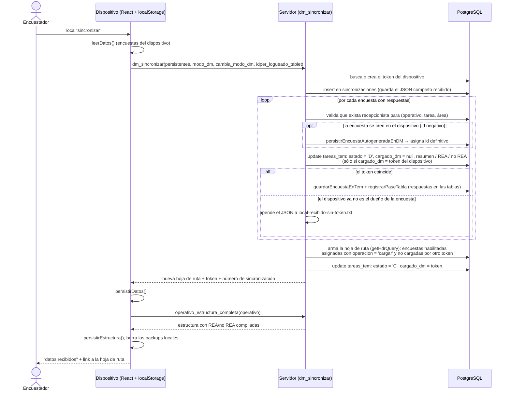
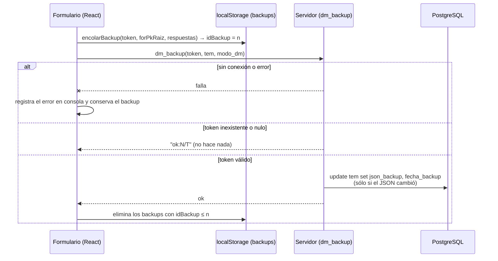
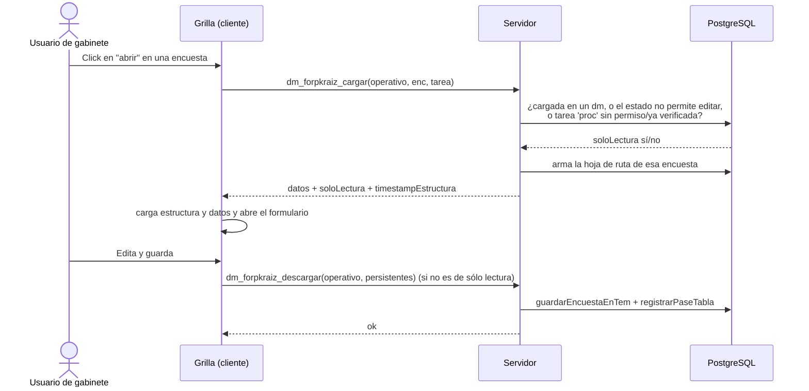

# Sincronización y funcionamiento offline

El dispositivo trabaja sin conexión: lleva consigo la **estructura** del formulario y las **encuestas asignadas** (hoja de ruta), y sólo se conecta para sincronizar y para enviar backups.

## Qué guarda el dispositivo

| Dato | Qué es | Dónde se guarda |
| :-- | :-- | :-- |
| Aplicación (shell, scripts, estilos) | La PWA misma | Service worker (`service-worker-admin`), se sirve sin sesión para que funcione sin cobertura |
| Estructura | Formularios, casilleros, variables, reglas de REA/no REA ya compiladas a JS (`operativo_estructura_completa`) | `localStorage` (vía `FormRenderer`, ver `src/unlogged/render-init.ts`) |
| Datos (`DatosByPassPersistibles`) | Respuestas por unidad de análisis, `cargas` (áreas), `informacionHdr` (datos de la encuesta y tarea), token, número de sincronización | `localStorage` |
| Backups | Cola de encuestas modificadas que aún no se enviaron | `localStorage`, clave `backups` |
| Modo DM | `produc` o `capa` | `localStorage` |
| Ayuda | Temas de ayuda del usuario, que se descargan al sincronizar (ver [ayuda-online.md](ayuda-online.md)) | `localStorage`, clave `ayuda` |
| Último login válido (`idper`, usuario) | Para seguir operando si se pierde la cookie de sesión | `localStorage` |

## Sincronización

Se hace desde la pantalla *sincronizar* (o *cambiar modo*) del dispositivo. En un solo paso el dispositivo **entrega** lo que tiene y **recibe** lo nuevo.

Consecuencias importantes de este diseño:

- **El token es el dueño de la encuesta.** Sólo el dispositivo cuyo token figura en `tareas_tem.cargado_dm` puede devolverla. Si la encuesta fue reasignada o descargada por gabinete, lo que envíe ese dispositivo no pisa la base: se escribe en `local-recibido-sin-token.txt` para recuperarlo a mano.
- **La carga a un dispositivo depende de `operacion = 'cargar'`**, que se marca desde gabinete (acción *cargar*, ver [tareas-estados-acciones.md](tareas-estados-acciones.md)). Sólo lo que esté en esa condición baja al dispositivo.
- **Descargar:** en cada sincronización el dispositivo entrega todo lo que tiene; lo que vuelve a bajar depende de `operacion = 'cargar'`. Si gabinete marca `operacion = 'descargar'`, o si el dispositivo cambia de modo o de usuario, la encuesta se entrega pero no se vuelve a cargar.
- **Cambio de modo (`produc` ↔ `capa`):** sólo si el operativo permite generar muestra; en caso contrario se rechaza. El cambio hace una sincronización con `cambia_modo_dm = true`.
- **Encuestas autogeneradas:** cuando el operativo lo permite, el encuestador crea encuestas en el dispositivo con un id provisorio negativo; el servidor les asigna el id definitivo al sincronizar o al recibir el backup.
- Los resultados que calcula el dispositivo (`resumenEstado`, REA y no REA) se guardan en `tareas_tem` con el prefijo `dm_` y luego se llevan a la TEM; ver [rea-no-rea.md](rea-no-rea.md).

## Backup continuo

Mientras el encuestador trabaja una encuesta, el formulario encola un backup (`encolarBackup`) y se intenta enviar al servidor sin interrumpirlo. Si no hay conexión simplemente se reintenta con el siguiente cambio.

- El backup **no cambia el estado** de la encuesta, sólo guarda `json_backup` en la TEM como respaldo.
- Si una encuesta autogenerada (id negativo) llega por backup, el servidor la registra igual.
- El backup guarda sólo el último JSON; la base no acumula versiones por backup.

## Rescate manual

Si un dispositivo no puede sincronizar (por ejemplo por un error al grabar), se entra a la pantalla `/salvar`: envía cada ítem de `localStorage` a `dm_rescatar`, que los agrega a `local-rescate.txt` en el servidor, y desregistra los service workers. Con ese archivo se puede reconstruir la encuesta a mano.

## Gabinete: abrir una encuesta

En gabinete se usa el mismo formulario del dispositivo, pero los datos se piden en línea con `dm_forpkraiz_cargar` y se graban con `dm_forpkraiz_descargar`:

La encuesta se abre en **sólo lectura** si está cargada en un dispositivo, si el estado no permite editarla y no está asignada al usuario, o si está en procesamiento y el usuario no puede procesar (o ya está verificada).

## Cambios de estructura

Cuando cambia la estructura del formulario (casilleros, semanas, REA/no REA) el servidor actualiza `timestampEstructura`. El dispositivo vuelve a pedir `operativo_estructura_completa` en la siguiente sincronización; mientras tanto trabaja con la estructura que tenía.
