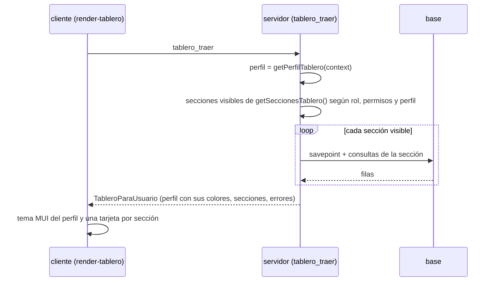

# Tablero de inicio (modo GABINETE)

En el modo GABINETE la primera opción del menú es **inicio**: un tablero en React + MUI con un panorama del operativo pensado para quien entra. Es la pantalla que se abre al ingresar (`selectedByDefault`). Las secciones que ve cada persona dependen de su rol y sus permisos, y los colores dependen de su **perfil**.

En RELEVAMIENTO (dispositivos) no aparece, y tampoco para quien no tiene ninguna otra opción de menú en GABINETE (por ejemplo el encuestador).

## Dónde está cada cosa

| Qué | Dónde |
| :-- | :-- |
| Perfiles, secciones de dmencu, visibilidad y armado | `src/server/tablero.ts` |
| Puntos de extensión del servidor (`getSeccionesTablero`, `getPerfilesTablero`, `getPerfilTablero`), procedimiento `tablero_traer` y opción de menú | `src/server/app-dmencu.ts` |
| Tipos compartidos servidor / cliente (`TableroParaUsuario`, `SeccionTablero`, `ContenidoTablero`, ...) | `src/unlogged/tipos-tablero.ts` |
| Pantalla (`myOwn.wScreens.tablero`), tema por perfil y componentes | `src/client/render-tablero.tsx` |
| Ayuda para usuarios | `ayuda/tablero.md` |
| Tests | `src/test/test-tablero.ts` |



El filtro se hace **en el servidor**: el cliente sólo recibe las secciones que le corresponden, ya calculadas. Cada sección corre en un `savepoint`: si una falla (por ejemplo porque una app no tiene alguna columna), se informa en `errores`, se escribe en el log del servidor y las demás se muestran igual.

## Perfiles

Un perfil agrupa roles que miran el operativo de la misma manera y define nombre, descripción y colores (primario y secundario del tema de MUI):

| Perfil | Roles (install/roles.tab) | Color |
| :-- | :-- | :-- |
| `administracion` | admin | gris azulado |
| `direccion` | direccion | índigo |
| `coordinacion` | coor_campo, subcoor_campo, coor_proc | verde azulado |
| `recepcion` | recepcionista, ingresador | azul |
| `procesamiento` | procesamiento | violeta |
| `diseno` | dis_conceptual | fucsia |
| `general` | cualquier otro | índigo claro |

Un rol que no está en `PERFIL_POR_ROL` toma el perfil según sus permisos (`perfilSegunRol`): superuser → administración, `campo.administrar` → coordinación, `encuestas.procesar` → procesamiento, `campo.editar` → recepción, `casilleros_texto.editar` → diseño; si no, general.

## Secciones de dmencu

Todas cuentan sobre las encuestas del operativo vigente (`parametros.operativo`) que el usuario ve: las de producción o de capacitación según `muestra_encuestas_prod` / `muestra_encuestas_capa`, igual que la grilla de la TEM.

| id | Orden | Para quién (alcanza con uno) | Contenido |
| :-- | :-: | :-- | :-- |
| `resumen` | 10 | `campo.ver`, `campo.editar`, `campo.administrar`, `encuestas.procesar` | muestra, salieron a campo, efectivas, en curso y tasa de respuesta; acceso a *control → resumen* |
| `mi_trabajo` | 15 | `campo.editar`, `encuestas.ingresar` | encuestas en su tarea actual asignadas al `idper` del usuario o en las que es recepcionista, por tarea y estado (no aparece si no tiene ninguna) |
| `avance` | 20 | ídem `resumen` | efectivas / en curso / no respuesta / no salieron a campo |
| `circuito` | 30 | ídem `resumen` | encuestas por `tarea_actual` |
| `estados` | 40 | ídem `resumen` | estado de cada encuesta en su tarea actual, en el orden de `estados.orden_estado` |
| `comunas` | 50 | `campo.administrar`, `encuestas.procesar` | efectivas sobre la muestra de cada comuna; acceso a *control → comuna* |
| `no_respuesta` | 60 | `campo.administrar`, `encuestas.procesar` | no respuestas por grupo de `no_rea` |
| `calendario` | 70 | ídem `resumen` | semana de carga en curso (`semanas.carga_enc_desde/hasta`) y días que le quedan |
| `dispositivos` | 80 | `campo.administrar` | sincronizaciones de hoy y de los últimos 7 días |
| `procesamiento` | 90 | `encuestas.procesar` | encuestas en la tarea final e inconsistencias vigentes sin justificar |
| `accesos` | 900 | todos | accesos directos a las opciones de primer y segundo nivel del menú del usuario |

Las categorías del avance salen de `tem`: **no salieron** si `resumen_estado` es nulo, **efectiva** si `resultado = 'efectiva'`, **no respuesta** si tiene `norea`, y **en curso** el resto (pendientes, mixtas, incompletas, con problemas). La **tasa de respuesta** es efectivas / (efectivas + no respuestas encuestables), donde no se cuentan los grupos de no respuesta que empiezan con `no encuestable` (como `tasa_efectividad` en control de campo).

El superuser ve todas las secciones. El acceso ("ver más") de una sección sólo se manda si el usuario tiene esa opción en su menú.

## Tipos de contenido

Cada sección devuelve un `ContenidoTablero`, que el cliente sabe dibujar:

| `tipo` | Se dibuja como |
| :-- | :-- |
| `indicadores` | tarjetas con número grande; si tienen `total`, barra de avance y porcentaje |
| `avance` | barra apilada con referencias y porcentajes |
| `barras` | una barra por fila (sobre su `total` o sobre el máximo); muestra 10 y un botón para ver todas |
| `tabla` | tabla simple; las columnas `numerica` se alinean a la derecha |
| `accesos` | botones agrupados por `grupo` que llevan a la opción del menú (con ctrl + clic, en otra pestaña) |
| `mensaje` | un aviso con el color del tono |
| `personalizado` | el componente que la app registró con `registrarComponenteTablero` |

Los tonos (`bueno`, `atencion`, `alerta`, `info`, `neutro`) se traducen a los colores del tema (`success`, `warning`, `error`, `primary`, gris).

## Cómo lo extienden las apps finales

### Servidor: agregar, reemplazar o quitar secciones

`getSeccionesTablero()` devuelve la lista completa; la app la sobreescribe. `combinarSecciones` reemplaza las que tienen el mismo `id` y agrega las nuevas; para quitar una, se filtra.

```ts
import { combinarSecciones, DefinicionSeccionTablero, numero, TEM_DEL_USUARIO } from "dmencu";

const seccionVisitasWeb: DefinicionSeccionTablero = {
    id: 'visitas_web',
    titulo: 'Respuestas por web',
    orden: 25,
    ancho: 'tercio',
    permisos: ['campo.administrar'],
    acceso: { titulo: 'ver encuestas', ruta: ['configurar', 'muestra', 'tem'] },
    async obtener({ client, operativo, quien }) {
        // TEM_DEL_USUARIO usa $1 = operativo y $2 = usuario
        var [fila] = (await client.query(`
            select count(*) as cantidad
                from ${TEM_DEL_USUARIO} join visitas_web v on v.operativo = t.operativo and v.vivienda = t.enc`,
            [operativo, quien.usuario]).fetchAll()).rows;
        return { tipo: 'indicadores', indicadores: [{ id: 'web', titulo: 'Por web', valor: numero(fila, 'cantidad'), tono: 'info' }] };
    }
};

// en la clase de la app (la que extiende la de dmencu)
getSeccionesTablero() {
    return combinarSecciones(
        super.getSeccionesTablero().filter(seccion => seccion.id != 'comunas'),
        [seccionVisitasWeb]
    );
}
```

Reglas para las secciones:

- `obtener` devuelve `null` cuando no hay nada para mostrar; la sección no aparece.
- Filtrar siempre por `operativo` y, si se cuenta sobre la TEM, usar `TEM_DEL_USUARIO` para respetar producción / capacitación.
- `permisos` y `roles` funcionan como en la ayuda: alcanza con tener alguno; vacíos, la ven todos. `perfiles` restringe además a esos perfiles.
- No escribir en la base: el tablero sólo consulta.

### Servidor: perfiles y colores

```ts
getPerfilesTablero() {
    return super.getPerfilesTablero().map(perfil =>
        perfil.perfil == 'direccion' ? { ...perfil, colores: { primario: '#004D40', secundario: '#FFB300' } } : perfil
    ).concat([{ perfil: 'sede', nombre: 'Sede', descripcion: 'Avance de la sede', colores: { primario: '#BF360C', secundario: '#546E7A' } }]);
}
getPerfilTablero(context: Context) {
    return context.user.rol == 'coor_sede' ? 'sede' : super.getPerfilTablero(context);
}
```

### Cliente: componentes propios y tema

Para dibujar algo que no cubren los tipos de contenido, la sección devuelve `{ tipo: 'personalizado', componente: 'mapa_areas', datos: {...} }` (`datos` es cualquier valor json) y la app registra el componente en su código de cliente:

```tsx
import { registrarComponenteTablero, setAjustarTemaTablero, PropsComponenteTablero } from "dmencu/dist/client/client/render-tablero";

function MapaAreas(props: PropsComponenteTablero) {
    return <div>...{JSON.stringify(props.datos)}</div>;
}
registrarComponenteTablero('mapa_areas', MapaAreas);

// opcional: retocar el tema de MUI de cada perfil
setAjustarTemaTablero((perfil, tema) => ({ ...tema, shape: { borderRadius: 4 } }));
```

`render-tablero.tsx` también exporta los componentes con que se dibujan los contenidos (`Indicadores`, `Avance`, `Barras`, `Tabla`, `Accesos`) para reutilizarlos dentro de un componente propio, y `irAlMenu(ruta)` para navegar a una opción del menú.

### Ayuda

Si la app agrega secciones, conviene contarlo en su propia versión del tema `tablero` de la ayuda (mismo `id`, ver [ayuda-online.md](ayuda-online.md)).
