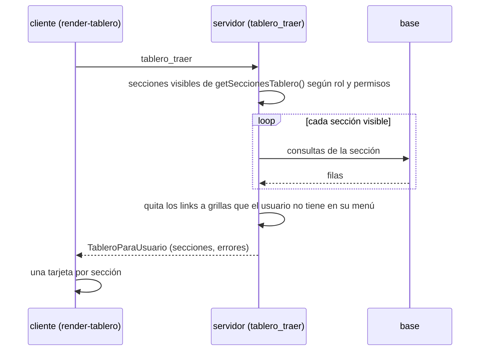

# Tablero de inicio (modo GABINETE)

En el modo GABINETE la primera opción del menú es **inicio**: un tablero en React + MUI con un panorama del operativo pensado para quien entra. Es la pantalla que se abre al ingresar (`selectedByDefault`). Las secciones que ve cada persona dependen de su **rol** y sus permisos; el aspecto es el mismo para todos. El panorama del operativo es de **coordinación para arriba**; quien sólo recibe encuestas (recepcionista, ingresador) ve lo suyo.

En RELEVAMIENTO (dispositivos) no aparece, y tampoco para quien no tiene ninguna otra opción de menú en GABINETE (por ejemplo el encuestador).

## Dónde está cada cosa

| Qué | Dónde |
| :-- | :-- |
| Secciones de dmencu, visibilidad por rol y permisos, armado y links | `src/server/tablero.ts` |
| Procedimiento `tablero_traer` y la función `tableroParaUsuario` que lo resuelve (sirve a cualquier frontend) | `src/server/procedures-dmencu.ts` |
| Punto de extensión del servidor (`getSeccionesTablero`) y opción de menú | `src/server/app-dmencu.ts` |
| Consultas de control de campo (`camposGruposNoRea`) | `src/server/table-control_campo.ts` |
| Tipos compartidos servidor / cliente (`TableroParaUsuario`, `SeccionTablero`, `ContenidoTablero`, ...) | `src/unlogged/tipos-tablero.ts` |
| Pantalla (`myOwn.wScreens.tablero`), tema y componentes | `src/client/render-tablero.tsx` |
| Ayuda para usuarios | `ayuda/tablero.md` |
| Tests | `src/test/test-tablero.ts` |



El filtro se hace **en el servidor**: el cliente sólo recibe las secciones que le corresponden, ya calculadas. El cliente vuelve a pedir el tablero solo cada 15 minutos (`INTERVALO_ACTUALIZACION_MS`, no cuando la pestaña está oculta) y mientras tanto muestra los datos anteriores.

Como `tablero_traer` está en `procedures-dmencu.ts` y devuelve datos, otro frontend puede consumirlo igual.

Los procedimientos corren dentro de una transacción de backend-plus y las secciones son sólo consultas, así que no se usan savepoints. Si una sección falla se informa en `errores` y se escribe en el log del servidor; como la transacción queda abortada por el error de la base, las secciones que corran después también fallan en esa carga.

## Dos tipos de instancia: de campo y de diseño

Una **app final** define un solo operativo y es de campo. La instancia de dmencu a secas se usa para **modelar varios operativos** (metadatos): no tiene campo. El tablero lo decide mirando la tabla `operativos`: con **más de un operativo** (`ConsultaTablero.variosOperativos`) es de **diseño**; con uno, de campo.

Cada sección declara su `ambito`: `'campo'` (el predeterminado), `'diseno'` o `'todos'`. `armarSecciones` descarta las que no son del ámbito de la instancia (`seccionDelAmbito`). En diseño no se muestra nada de campo (panorama, recepción, calendario, dispositivos) y **todos** los usuarios con menú ven las secciones de diseño, sin filtrar por rol.

| id | Orden | Ámbito | Contenido |
| :-- | :-: | :-- | :-- |
| `operativos` | 10 | diseño | tabla con una fila por operativo: si el diseño está cerrado (`operativos.disform_cerrado`), formularios, preguntas, variables, consistencias, las inactivas o inválidas y los problemas que marca el editor de metadatos (errores, faltan datos y avisos, los mismos que se ven al editar: `problemasDeMetadatos`); acceso al *editor visual* |
| `accesos` | 900 | todos | accesos directos del menú |

## Secciones de campo

Los números de campo salen del **sql de las tablas de control** (`control_resumen`, `control_campo_dominio`, `control_campo_zona`, `control_campo_comuna`, `control_campo_area`), el mismo que usan las grillas del menú *control*: así el tablero y las grillas coinciden siempre. Para eso `ConsultaTablero.tabla(nombre)` devuelve la definición de la tabla y la sección usa su `sql.from`.

| id | Orden | Para quién | Contenido |
| :-- | :-: | :-- | :-- |
| `resumen` | 10 | roles de coordinación para arriba (ver abajo) | muestra, salieron a campo, efectivas, en curso y tasa de respuesta (la tasa de efectividad de control de campo); acceso a *control → resumen* |
| `para_asignar` | 12 | `campo.editar` | encuestas de las que el usuario es recepcionista (`tareas_tem.recepcionista` = su persona) cuyo estado **permite asignar y no se ve en recepción** (por ejemplo *Disponible*): una tarjeta por tarea con el detalle por estado y link a la grilla de **asignación**; no aparece si no tiene ninguna |
| `para_recibir` | 14 | `campo.editar` | las encuestas del usuario cuyo estado **se ve en recepción** (`estados.visible_en_recepcion`), por tarea y estado, con link a la grilla de **recepción** |
| `recepcionistas` | 18 | roles de coordinación para arriba | tabla con cada recepcionista (y las encuestas sin recepcionista): cuántas faltan asignar y cuántas están en recepción, con el total; acceso a *asignación → general* |
| `mi_avance` | 16 | `campo.editar` | barra de avance de campo **sobre las encuestas del usuario como recepcionista** (`control_resumen_recepcion`: el sql de control_resumen filtrado por su recepción) |
| `avance` | 20 | ídem `resumen` | barra grande, a todo el ancho: efectivas / en curso / no respuesta / no salieron a campo, con la cantidad en cada tramo y los porcentajes en las referencias |
| `no_respuesta` | 25 | ídem `resumen` | no respuestas por grupo (los grupos de `control_resumen`) |
| `desglose` | 30 | ídem `resumen` | barras apiladas por **dominio, zona, comuna y área**, con selector entre los cortes y link a la grilla de control de cada uno; cada segmento muestra su cantidad, el total queda pegado al final de la barra, que es más corta cuanto menor es el total respecto del mayor del corte, los porcentajes están en la leyenda y el total del corte al pie |
| `circuito` | 40 | ídem `resumen` | una tarjeta por tarea del operativo (también las que tienen 0) con la cantidad de encuestas en esa `tarea_actual` y link a la grilla de la tarea, más una tarjeta *sin asignar* (sin `tarea_actual`) al principio, y el total de encuestas al pie (que debe coincidir con la muestra), en el orden del circuito (ver abajo) |
| `estados` | 50 | ídem `resumen` | *Estados por tarea*: encuestas por tarea actual y estado, con el código y la descripción del estado (por ejemplo *Tarea: encuestador Estado: A (Asignada)*), con link a la grilla de la tarea (si el usuario la tiene en su menú), en el orden del circuito y de `estados.orden_estado`; las que no tienen estado van como *sin estado*; el total al pie coincide con la muestra |
| `calendario` | 70 | `campo.ver`, `campo.editar`, `campo.administrar`, `encuestas.procesar` | semana de carga en curso (`semanas.carga_enc_desde/hasta`) y días que le quedan |
| `dispositivos` | 80 | `campo.administrar` | sincronizaciones de hoy y de los últimos 7 días |
| `accesos` | 900 | todos | accesos directos a las opciones de primer y segundo nivel del menú del usuario |

**Coordinación para arriba** es `ROLES_DE_COORDINACION`: admin, direccion, coor_campo, subcoor_campo, coor_proc y procesamiento (el superuser ve todo). No se define por un permiso porque ninguno separa a esos roles del resto (`campo.administrar` no lo tiene dirección ni procesamiento). Una app con otros roles sobreescribe `getSeccionesTablero`.

**Tarea vigente (sólo en *para asignar* y *en recepción*):** las encuestas disponibles (todavía sin asignar) no tienen `tem.tarea_actual`. Los triggers (`asignar_desasignar_tareas_tem_trg`, `validar_tareas_tem_trg`) las consideran en la **tarea inicial** (`tareas.es_inicial`), y estas dos secciones hacen lo mismo: `TEM_DEL_USUARIO` agrega `tarea_vigente = coalesce(tarea_actual, tarea inicial)`. En *dónde están las encuestas* y *estados por tarea*, en cambio, se cuenta por `tarea_actual`, y las que no la tienen van aparte como *sin asignar* (en estados, *sin tarea*), con link a la `tem` con `tarea_actual` vacía.

**Asignar o recibir:** un estado con `permite_asignar` y sin `visible_en_recepcion` (como *Disponible*) se ve en la asignación y no en la recepción, por eso `para_asignar` y `para_recibir` son disjuntas: si el estado se ve en recepción, cuenta como "en recepción" aunque también permita asignar.

Las secciones de `circuito`, `estados`, `para_asignar` y `para_recibir` cuentan sobre las encuestas del operativo vigente (`parametros.operativo`) que el usuario ve: producción o capacitación según `muestra_encuestas_prod` / `muestra_encuestas_capa` (`TEM_DEL_USUARIO`).

Las partes del avance (`partesDeControl`): **efectivas** es `rea`, **en curso** es `en_curso`, **no salieron** es `no_salieron` y **no respuesta** es lo que queda de las que salieron.

### Orden de las tareas

`ordenarTareas` ordena las tareas con los pases de `tareas_proximas`: primero las que están en la cadena de pases, por la mayor cantidad de pases que hay hasta ellas (los pases hacia atrás se ignoran); después las que no tienen ningún pase (por ejemplo `anac`, que no figura en `tareas_proximas`) y al final la tarea `es_final`. A igual lugar, la `es_inicial` primero y después por código. Con los pases de la instalación de ejemplo da `encu`, `recu`, `supe`, `finc`, `anac`, `proc`. `mi_recepcion` usa el mismo orden.

### Links a las grillas

Un link sólo se manda si el usuario tiene esa opción en su menú (`conAccesoVisible`), así que nunca se ofrece una grilla a la que no puede entrar. Los links por tarea salen de `RUTA_POR_TAREA`:

| Tarea | Opción del menú |
| :-- | :-- |
| `finc` | `tareas_tem_fin_campo` |
| `anac` | `tareas_tem_analisis_campo` |
| `proc` | `procesar` → `tareas_tem_procesamiento` |
| las demás (relevamiento: `encu`, `recu`, `supe`, ...) | en *dónde están las encuestas*: la grilla de *recepción* de la tarea (`RUTA_RECEPCION_POR_TAREA`). En *estados por tarea*: `configurar` → `muestra` → `tareas_tem` (*tareas de las encuestas*), que sólo tiene el menú de coordinación para arriba (`campo.administrar` o `encuestas.procesar`) |

Los links de *estados por tarea* abren la grilla filtrada con `ff` en la url (campos fijos de backend-plus, igual que los items del menú con `ff`): en `tareas_tem` por `tarea` y `estado`; en las grillas de una sola tarea (fin de campo, análisis de campo, procesamiento), sólo por `estado`; sin estado, sólo por tarea. Las encuestas sin tarea (`tarea_actual` nula) van a la `tem` (*configurar → muestra → TEM*) con `tarea_actual` vacía. Se arma con `AccesoTablero.filtro` y `hrefDelMenu(ruta, filtro)`. Los demás links abren la grilla entera. *Para asignar* usa las grillas de *asignación* y *en recepción* las de *recepción* (`RUTA_ASIGNACION_POR_TAREA`, `RUTA_RECEPCION_POR_TAREA`).

El superuser ve todas las secciones.

## Tipos de contenido

Cada sección devuelve un `ContenidoTablero`, que el cliente sabe dibujar:

| `tipo` | Se dibuja como |
| :-- | :-- |
| `indicadores` | tarjetas con número grande (y, si tiene `total`, "Total: N encuestas" al pie); si tienen `total`, barra de avance y porcentaje; si tienen `acceso`, un link |
| `avance` | barra grande apilada con la cantidad de cada parte y, debajo, sus referencias con cantidad y porcentaje |
| `desglose` | barras apiladas por fila con un selector entre cortes (`cortes`) |
| `barras` | (con `total`, también "Total: N encuestas" al pie) una barra por fila (sobre su `total` o sobre el máximo); muestra 10 y un botón para ver todas |
| `tabla` | tabla simple; las columnas `numerica` se alinean a la derecha |
| `accesos` | botones agrupados por `grupo` que llevan a la opción del menú (con ctrl + clic, en otra pestaña) |
| `mensaje` | un aviso con el color del tono |
| `personalizado` | el componente que la app registró con `registrarComponenteTablero` |

Los tonos (`bueno`, `atencion`, `alerta`, `info`, `neutro`) se traducen a los colores del tema (`success`, `warning`, `error`, `primary`, gris).

## Cómo lo extienden las apps finales

### Servidor: agregar, reemplazar o quitar secciones

`getSeccionesTablero()` devuelve la lista completa; la app la sobreescribe. `combinarSecciones` reemplaza las que tienen el mismo `id` y agrega las nuevas; para quitar una, se filtra.

```ts
import { combinarSecciones, DefinicionSeccionTablero, numero, TEM_DEL_USUARIO } from "dmencu";

const seccionVisitasWeb: DefinicionSeccionTablero = {
    id: 'visitas_web',
    titulo: 'Respuestas por web',
    orden: 25,
    ancho: 'tercio',
    permisos: ['campo.administrar'],
    acceso: { titulo: 'ver encuestas', ruta: ['configurar', 'muestra', 'tem'] },
    async obtener({ client, operativo, quien }) {
        // TEM_DEL_USUARIO usa $1 = operativo y $2 = usuario
        var [fila] = (await client.query(`
            select count(*) as cantidad
                from ${TEM_DEL_USUARIO} join visitas_web v on v.operativo = t.operativo and v.vivienda = t.enc`,
            [operativo, quien.usuario]).fetchAll()).rows;
        return { tipo: 'indicadores', indicadores: [{ id: 'web', titulo: 'Por web', valor: numero(fila, 'cantidad'), tono: 'info' }] };
    }
};

// en la clase de la app (la que extiende la de dmencu)
override getSeccionesTablero() {
    return combinarSecciones(
        super.getSeccionesTablero().filter(seccion => seccion.id != 'desglose'),
        [seccionVisitasWeb]
    );
}
```

Reglas para las secciones:

- `obtener` devuelve `null` cuando no hay nada para mostrar; la sección no aparece.
- No repetir consultas: si ya existe una (en una tabla `control_*`, o una constante como `TEM_DEL_USUARIO` o `resumenDeControl`), se reutiliza.
- Filtrar siempre por `operativo` y, si se cuenta sobre la TEM, usar `TEM_DEL_USUARIO` para respetar producción / capacitación.
- `permisos` y `roles` funcionan como en la ayuda: alcanza con tener alguno; vacíos, la ven todos.
- No escribir en la base: el tablero sólo consulta.

### Cliente: componentes propios y tema

Para dibujar algo que no cubren los tipos de contenido, la sección devuelve `{ tipo: 'personalizado', componente: 'mapa_areas', datos: {...} }` (`datos` es cualquier valor json) y la app registra el componente en su código de cliente:

```tsx
import { registrarComponenteTablero, setAjustarTemaTablero, PropsComponenteTablero } from "dmencu/dist/client/client/render-tablero";

function MapaAreas(props: PropsComponenteTablero) {
    return <div>...{JSON.stringify(props.datos)}</div>;
}
registrarComponenteTablero('mapa_areas', MapaAreas);

// opcional: retocar el tema de MUI (colores, bordes, etc.)
setAjustarTemaTablero(tema => ({ ...tema, shape: { borderRadius: 4 } }));
```

`render-tablero.tsx` también exporta los componentes con que se dibujan los contenidos (`Indicadores`, `Avance`, `Desglose`, `Barras`, `Tabla`, `Accesos`) para reutilizarlos dentro de un componente propio, y `irAlMenu(ruta)` para navegar a una opción del menú.

### Ayuda

Si la app agrega secciones, conviene contarlo en su propia versión del tema `tablero` de la ayuda (mismo `id`, ver [ayuda-online.md](ayuda-online.md)).
