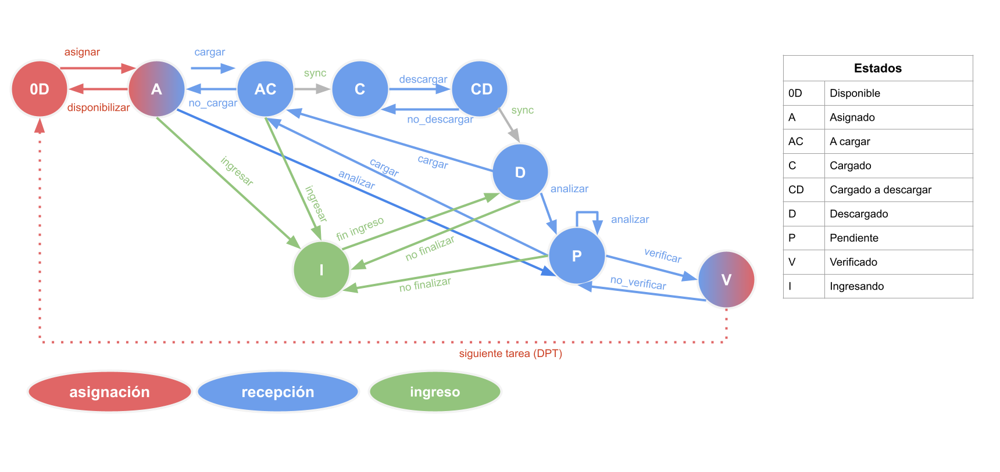
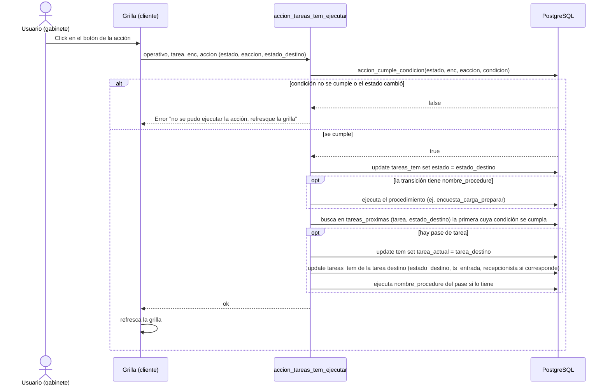

# Tareas, estados y acciones

El recorrido de cada encuesta por el sistema (asignación a un encuestador, carga al dispositivo, descarga, verificación, ingreso, pase a la tarea siguiente...) lo define un **workflow configurable por operativo** a partir de cuatro tablas. Nada de esto está fijo en el código: los estados y las acciones se cargan como datos de cada operativo.

El grafo muestra el circuito estándar. Los colores indican quién actúa: **asignación** (rojo, gabinete asigna), **recepción** (azul, circuito con el dispositivo y verificación) e **ingreso** (verde, carga manual en gabinete). Las flechas grises (`sync`) las dispara el dispositivo al sincronizar; el resto son acciones que ejecuta una persona desde las grillas.

## Conceptos

| Tabla | Qué define |
| :-- | :-- |
| `tareas` | Etapas del circuito (`encu`, `recu`, `supe`, `ingr`, `finc`, `anac`, `proc`...). Marca la tarea inicial (`es_inicial`) y la final (`es_final`), el formulario principal (`main_form`) y si permite borrar elementos de la UA |
| `estados` | Estados posibles de una tarea (`0D`, `A`, `AC`, `C`, `CD`, `D`, `P`, `V`, `I`...). Cada uno indica si permite asignar (`permite_asignar`), si permite editar la encuesta (`permite_editar_encuesta`), y en qué grillas es visible (`visible_en_recepcion`, `_ingreso`, `_fin_campo`, `_analisis_campo`, `_procesamiento`) |
| `acciones` | Las acciones que una persona puede ejecutar (ícono, si pide confirmación, a qué grilla pertenece: recepciona, ingresa, fin de campo, análisis de campo, procesa) |
| `estados_acciones` | Transiciones: desde `estado`, con la acción `eaccion`, si se cumple `condicion` (SQL), se pasa a `estado_destino`. Opcionalmente ejecuta el procedimiento `nombre_procedure` |
| `tareas_proximas` | Pase de tarea: cuando una tarea llega a cierto `estado`, y se cumple `condicion` (en orden de `orden`), la encuesta pasa a `tarea_destino` con `estado_destino` |
| `tareas_tem` | El estado actual de cada encuesta en cada tarea (una fila por encuesta y tarea) |
| `tem.tarea_actual` | La tarea en la que está hoy la encuesta. Sólo una tarea por encuesta está "activa" |

## Estados del grafo estándar

| Estado | Nombre | Significado |
| :-- | :-- | :-- |
| `0D` | Disponible | Sin asignar; se puede asignar |
| `A` | Asignado | Asignado a una persona (encuestador, recuperador, supervisor o ingresador) |
| `AC` | A cargar | Marcada para cargarse en el dispositivo en la próxima sincronización |
| `C` | Cargado | El dispositivo la tiene (`cargado_dm` guarda el token del dispositivo) |
| `CD` | Cargado a descargar | Marcada para que el dispositivo la devuelva en la próxima sincronización |
| `D` | Descargado | La encuesta volvió del dispositivo |
| `P` | Pendiente | Esperando verificación de recepción |
| `V` | Verificado | Verificada; habilita el pase a la tarea siguiente |
| `I` | Ingresando | Se está cargando la encuesta en gabinete (sin dispositivo) |

> Los estados y las transiciones son datos de cada operativo; ese grafo es el circuito más común. Un operativo puede agregar otros (por ejemplo `CC`, que usa el pase a análisis de campo) y el código sólo conoce algunos por nombre: `0D` (estado inicial), `C` (posterior a la carga), `D` (posterior a la descarga), `V` (verificado) y `CC`.

## Transiciones y qué ejecuta cada una

| Transición del grafo | Acción / procedimiento | Qué hace en la base |
| :-- | :-- | :-- |
| `0D → A` asignar | edición de `asignado` en la grilla de asignación | Se asigna a una persona; el trigger valida y fija `tem.tarea_actual` |
| `A → 0D` disponibilizar | `encuesta_disponibilizar` | `asignado = null` |
| `A → AC` cargar | `encuesta_carga_preparar` | `operacion = 'cargar'` |
| `AC → A` no_cargar | `encuesta_no_cargar` | `operacion = null` |
| `AC → C` sync | `dm_sincronizar` (lo dispara el dispositivo) | Estado `C` y `cargado_dm = token` |
| `C → CD` descargar | `encuesta_descarga_preparar` | `operacion = 'descargar'` |
| `CD → C` no_descargar | `encuesta_no_descargar` | Vuelve a `operacion = 'cargar'` (la encuesta sigue en el dispositivo) |
| `CD → D` sync | `dm_sincronizar` | La encuesta vuelve al servidor; estado `D` y `cargado_dm = null` |
| `D → P` analizar, `P → P` analizar | `encuesta_analizar` | Corre las consistencias de la encuesta (`consistir_encuesta`) y registra las inconsistencias |
| `P → V` verificar | `encuesta_verificar` (con `inconsistencias_encuesta_controlar` como control previo) | `verificado = '1'`; no deja verificar si quedan inconsistencias sin justificar |
| `V → P` no_verificar | `encuesta_no_verificar` | Revierte la verificación |
| `A → I`, `AC → I` ingresar | acción de ingreso | Se carga la encuesta desde gabinete |
| `I → D` fin ingreso, `D`/`P → I` no finalizar | acciones de ingreso | |
| `V → 0D` siguiente tarea (DPT) | `tareas_proximas` | La encuesta pasa a la tarea destino con el estado inicial |

Los nombres exactos de acciones y condiciones de cada operativo se consultan en las grillas de `acciones` y `estados_acciones` (menú *configurar → estados_acciones_tareas*).

## Cómo se ejecuta una acción

Puntos a tener en cuenta:

- La condición se evalúa **en la base** (`accion_cumple_condicion`, `tarea_cumple_condicion`) y, además, la encuesta debe estar **habilitada** (`tem.habilitada`). Así la validación no depende de lo que muestre el cliente.
- Si el estado que ve el usuario ya no es el real (otra persona la modificó), la acción se rechaza y hay que refrescar.
- La acción, el procedimiento asociado y el pase de tarea corren en el mismo procedimiento del backend, con el mismo cliente de base de datos de la request.
- Al cambiar `tem.tarea_actual`, un trigger guarda una foto en `historial_tem` (ver [arquitectura.md](arquitectura.md)).

## Operaciones especiales de gabinete

Fuera del circuito normal existen procedimientos para casos excepcionales: `encuesta_forzar_tarea` (mueve la encuesta a otra tarea dejando la actual como `V` y la nueva como `0D`), `encuesta_habilitar_deshabilitar` (alterna `tem.habilitada`), `encuesta_pasar_a_anac` y sus inversas (pase a análisis de campo), `encuesta_blanquear`, `encuesta_borrar`, `intercambiar_encuestas` y `encuesta_capa_a_prod_pasar`. Se ofrecen según los permisos del rol; ver [roles-y-permisos.md](roles-y-permisos.md).

## Desverificación excepcional

La transición `V → P` (`encuesta_no_verificar`) sólo funciona mientras la encuesta sigue en la tarea verificada. Cuando ya pasó a la tarea siguiente y ésta quedó asignada (por ejemplo `finc`, que se asigna sola), el trigger `desverificar_tarea_trg` la rechaza. Para esos casos está el procedimiento `encuesta_desverificar_excepcional` (`encuestaDesverificarExcepcional` en `procedures-dmencu.ts`) y la grilla **desverificables** (menú *varios → desverificar encuestas*, `table-desverificables.ts`).

- **Quién**: `subcoor_campo`, `coor_campo`, `coor_proc`, `procesamiento` y `admin` (`ROLES_DESVERIFICAN`). El recepcionista no la ve.
- **Qué lista**: encuestas cuya última tarea en `historial_tem` está verificada y cuya tarea actual no. La grilla se arma sólo con `sqlDesverificables` (`sql.from`, sin `where`), la misma consulta que usa el procedimiento, e incluye el estado destino.
- **No saltea los triggers**. En una sola transacción:
  1. deja la tarea actual en `0D` y sin asignar (con la tarea actual todavía vigente, así `validar_tareas_tem_trg` lo acepta);
  2. mueve `tem.tarea_actual` a la tarea verificada: `agregar_historial_tem_trg` guarda la foto de la tarea que se deja;
  3. completa esa foto de `historial_tem` con el estado y el asignado que tenía antes de limpiarla, y con `usuario_accion` y `motivo` (obligatorio);
  4. llama a `encuesta_no_verificar`: como la tarea verificada ya es la actual, `desverificar_tarea_trg` lo acepta;
  5. pone la tarea desverificada en el estado destino.
- **Estado destino**: se infiere de `estados_acciones` (dentro de `sqlDesverificables`): las transiciones desde el estado de la tarea verificada cuyo `nombre_procedure` es `encuesta_no_verificar`. Si hay una sola se usa; si hay varias se toma la inmediatamente anterior al estado verificado según `estados.orden_estado` (por ejemplo `V` tiene `no_verificar → P` y `no_cerrar → A`: vuelve a `P`); si no hay ninguna, falla. La grilla muestra la descripción de los estados de origen y destino con `softForeignKeys` a `estados` (las trae backend-plus, no el sql) y el destino se confirma junto con el motivo.
- **Bases ya instaladas**: `operaciones/2026-10-19-actualizar_desverificar_excepcional.sql` agrega `usuario_accion` y `motivo` a `historial_tem` (las bases nuevas las toman de `table-historial_tem.ts`).
- El estado `0D` es el inicial que el código ya conoce (ver arriba). Esta operación no está en el tablero de inicio porque no es un control de seguimiento sino una herramienta de corrección.
